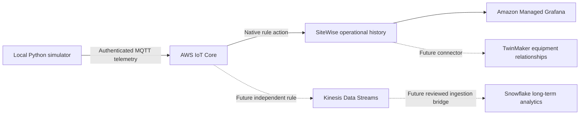

# Proposed Adage operational telemetry experiment

Status: design for human review, not implemented or deployed. Owner/evaluator: Ted
and repository maintainer. Baseline: deterministic local five-asset simulation,
immutable transition traces and offline dashboard are implemented and tested; there
is no verified SiteWise/Managed Grafana operational path. Target: a reproducible
synthetic consequence progression visible in a managed operational dashboard.
Core2 is retired. ATOM Lite remains the sole physical device, but this experiment
starts with a local Python producer and does not require any device operations.

## Architecture and scope

This is an additive experiment proposal, not a change to existing simulator rules,
observation format or Issue #17 reset/ACK acceptance. It deliberately introduces
SiteWise for operational history: the new requirement supersedes the earlier
SiteWise deferral for this experiment only. Physical reset with a local producer
would need a later authenticated command subscriber and committed receipt design;
existing DynamoDB/Lambda contracts do not automatically reset a local process.
MQTT PUBACK never proves SiteWise ingestion, dashboard visibility or reset completion.

## Reuse and gaps

| Repository/capability | Evidence and intended use |
| --- | --- |
| iot-digital-twin | GridSimulator, opt-in immutable traces, replay/reset tests, local dashboard; reuse model unchanged and add an injected MQTT transport adapter |
| aws-config | Closed schemas, readiness checks, environment bindings and /iac/component/nickname/config contracts; keep secrets outside Git/SSM declarations |
| aws-iac | Terraform/Terragrunt components, state isolation, SSM runtime discovery, non-mutating gates, plan/approval workflow; reuse these conventions |
| aws-iac grafana | Existing EC2/Kafka Connect/ALB deployment, not Managed Grafana; do not deploy or repurpose it for this slice |
| Shared s3-bucket | Existing reviewed artifact bucket/state ownership; preserve it, do not adopt it into new state or use it as telemetry storage |
| Pending coordinated PRs | aws-iac #16 / aws-config #8 consolidate canonical ATOM component; aws-lambda #2 implements bounded durable reset runtime. These are open, not deployed proof |
| Missing | Python MQTT/TLS adapter, SiteWise model/assets/property bindings, IoT rule/action IAM/error logging, Managed Grafana workspace/auth/data source/dashboard, local/live acceptance evidence |

Review snapshots: see PR bodies for exact main revisions. Adage's control model is
configuration -> SSM -> Terraform -> runtime metadata; configuration is not approval.
No SiteWise, Managed Grafana, Kinesis or Snowflake implementation was found in the
three reviewed repositories. Existing historical docs are hypotheses, not deployments.

## Smallest independently verifiable milestone: M1

One existing simulated asset, one INTEGER severity measurement, 20 wall-clock-paced
observations in a bounded run. A scoped TLS client publishes to one exact topic;
a native IoT SiteWise rule maps values to one reviewed asset/property. An independent
SiteWise API reader verifies all expected timestamp/value pairs after publication
stops. Target: 19/20 visible within 10 seconds and 20/20 within 60 seconds; timeout
is a recorded failure, not an automatic retry until green. Grafana is not needed
to prove M1. First test contracts entirely offline; live execution requires approval.

Proposed acceptance IDs (not yet added to executable acceptance coverage):
- OP-01: identical model/trace input gives identical MQTT envelope except injected
  run ID and wall-clock timestamp; invalid identity, severity and timestamps fail locally.
- OP-02: 20 independently read SiteWise observations match the run manifest;
  unauthorized topic/alias attempts are denied and reported after separate test approval.
- OP-03: five-asset dashboard shows latest severity, progression history and freshness,
  with a witnessed screen capture; a stopped publisher becomes visibly stale.
No proposed ID is claimed as satisfied by this documentation PR.

## Proposed wire contract and failure behavior

Keep original observation nested unchanged. Add schema_version=1, synthetic=true,
run_id (operator-generated 128-bit ID), asset_id, epoch, sequence, tick, severity,
event_time_seconds and event_time_nanos; reject unknown fields and bool-as-integer.
Event key is (run_id, asset_id, epoch, sequence); outer fields must agree with the
nested observation. severity is 0 HEALTHY, 1 WARNING, 2 CRITICAL. The accelerated
simulation clock is metadata, not a SiteWise ingest timestamp. Inject UTC start time
plus monotonic pacing so wall-clock timestamps are unique and in the service window;
a backward clock jump stops the producer. Replay uses new run IDs/timestamps without
claiming cloud event bytes identical. Do not publish historical synthetic dates.

Initial topic: adage/iot-digital-twin/operational-demo/asset-000/telemetry.
For five assets, generate five exact topic/property mappings from an allowlist, never
accept an arbitrary property alias from payload. Proposed alias namespace:
/adage/iot-digital-twin/operational-demo/asset-000/severity. Validate SQL predicates,
TQV INTEGER value, timestamp and GOOD quality in fixture tests. MQTT client identity
is separate from physical ATOM identity. Bind each authorized topic to its property.
QoS 1 permits duplicates; bounded retries reuse the same timestamp/value/event key.
Do not promise exactly-once or assume SiteWise enforces sequence/epoch fencing.
M1 stops on timeout, rejects malformed local inputs, retains a bounded run manifest,
and uses rule error logging for cloud failures. Independent readback checks missing,
duplicate/conflicting and unexpected values; persistent failures fail the milestone.
No durable local spooling or reconnect catch-up in M1. Later stale/out-of-order input
requirements may justify an aws-lambda validation adapter; do not add one preemptively.

## Phases and ownership

1. Review this proposal and resolve operator profile/account/region, exact resource
   ownership, certificate issuance, SiteWise availability, Grafana auth and budget.
   Current historical read-only evidence: account 623155450153, us-east-1, shared
   artifact bucket exists; no current iot-digital-twin state objects were listed.
   Application inventory was denied. Recheck: AccessDenied is never resource absence.
2. iot-digital-twin: implement serializer/transport injection and bounded launch command,
   dry-run by default. Use one reviewed MQTT library only if required; hash-lock it.
   Tests cover TLS settings, rate/tick bounds, partial failures, duplicates, timestamp
   policy, mapping accuracy and preservation of simulator replay/reset/traces.
3. aws-config/aws-iac: implement strict proposed operational mode/dependencies and
   minimal SiteWise ingestion slice. Resolve pending consolidation/version compatibility
   before coding; do not silently change a v1 contract or create per-experiment components.
   Test mocked provider/IAM/rule mappings and saved plan; human approval precedes apply,
   certificate/policy attachment and all telemetry publishing. Execute M1 and stop.
4. Add reusable Managed Grafana capability, one workspace, existing approved Identity
   Center or SAML auth, customer-managed read-only SiteWise role, one datasource and
   one versioned dashboard. Five assets use severity/epoch/sequence measurements,
   latest health tiles and history; show data age separately from health. Rehearse a
   60-second progression with six ticks spaced three wall seconds apart, then stop.
   Reset demonstration initially stays local and labelled; no physical/cloud ACK claim.
5. Future TwinMaker: map stable equipment/asset IDs and relationships, consume SiteWise
   through supported connector; no new inference engine. Future parallel analytics:
   second IoT rule -> Kinesis -> explicitly chosen Snowflake ingestion bridge. Preserve
   event IDs, source time, schema and synthetic labels for deduplication and backfill;
   operational failure must not wait for Snowflake. No analytics resources in M1/M2.

## Costs, retention and operational controls

Planning estimate only, US East reference, no free-tier assumption. For five assets,
1 publication/second each, 10 minutes/day, 30 days: 90,000 MQTT messages and up to
270,000 property values for three measurements. IoT messaging roughly $0.09 and
SiteWise ingestion roughly $0.27 using published $1/million reference examples;
rule actions, storage, retrieval and logs add usage charges. Rates/metering must be
recalculated for the exact plan. Reserve $2/month for this bounded usage, not 24/7.
Managed Grafana is the main floor: $9 active editor/admin and $5 active viewer/month,
minimum one editor per workspace; API/service-account activity can add licenses.
Plan about $15–25/month for one editor, optional viewer and one optional automation
identity, plus a proposed $30 alert threshold (alert is not a hard spending cap).
M1 without Grafana should be under $1 for a few short runs, excluding shared costs.
No EC2, NAT, gateway, SiteWise Monitor portal, alarms or paid Grafana plugins required.
Kinesis/Snowflake/TwinMaker costs are excluded until their separate plans.

SiteWise owns operational history; Snowflake will own longer-term analytics later,
not simulator control state. Do not shorten operational retention before successful
analytics delivery/backfill/reconciliation. SiteWise hot-tier retention settings have
account-wide implications; a finite hot window requires appropriate tier configuration.
M1 does not change account storage configuration. Review a 30-day operational window
later; default hot storage may retain indefinitely and must be costed. Do not invent
per-asset TTL. Stop producer/rules to bound ingestion; retain evidence and export required
history before approved asset deletion. Grafana queries are read-only. Track rule errors,
missing points, freshness and actual billing; maintainer owns recovery and evidence.

Teardown proposal: stop local publisher, disable only owned rule, retain/export evidence,
remove owned dashboard/workspace (review license timing), then owned assets/model,
rule role/logs and only newly issued local-producer credentials after approval.
Never delete shared artifact bucket, state backend, Identity Center or ATOM credentials.
Destruction requires an independently reviewed saved plan and data-retention decision.

## References checked for this proposal

- [Adage](https://github.com/usekarma/adage): ownership and config/runtime bridge.
- [Native SiteWise IoT rule](https://docs.aws.amazon.com/iot-sitewise/latest/userguide/configure-rule-action.html).
- [SiteWise storage configuration](https://docs.aws.amazon.com/iot-sitewise/latest/userguide/configure-storage.html).
- [SiteWise pricing](https://aws.amazon.com/iot-sitewise/pricing/), [IoT pricing](https://aws.amazon.com/iot-core/pricing/), [Managed Grafana pricing](https://aws.amazon.com/grafana/pricing/).
- [Grafana/SiteWise](https://docs.aws.amazon.com/grafana/latest/userguide/using-iotsitewise-in-AMG.html), [workspace API](https://docs.aws.amazon.com/grafana/latest/APIReference/API_CreateWorkspace.html).
- [Future Kinesis/Snowflake connector](https://docs.snowflake.com/en/user-guide/data-integration/openflow/connectors/kinesis/about): requires a connector, not automatic native routing.
